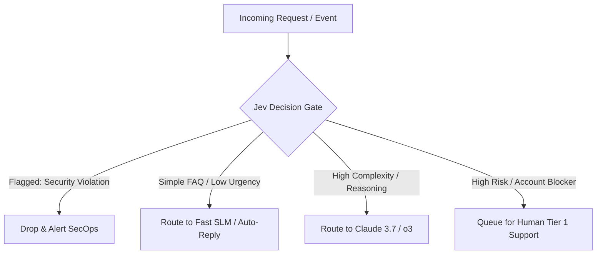

In modern AI engineering, teams frequently fall into a costly anti-pattern: **using multi-billion-parameter autoregressive models for simple classification, routing, and verification tasks.**

When an incoming customer ticket needs triage, a user prompt requires security filtering, or an autonomous browser agent must select the next button to click, invoking a generative model like GPT-4o or Claude 3.7 introduces:
1. **Multi-second latency** waiting for token generation.
2. **Parsing overhead** with fragile JSON output schemas.
3. **Runaway API costs** burning token budgets on binary yes/no decisions.

Enter **TypeSafe AI's Jev**—a specialized **decision model** engineered not to generate paragraphs of text, but to evaluate typed, deterministic questions directly over state in sub-second latency.

In this article, we explore how decision models fundamentally differ from text generators, analyze six production use cases, and implement an end-to-end hybrid triage gate in Python.

---

## 1. Paradigm Shift: Text Generation vs. Deterministic Verdicts

Traditional LLMs predict the next token in a sequence. To make a decision, an LLM must generate text tokens that your application then deserializes and validates:

```
[Prompt + Context] ──► [Autoregressive Generation] ──► "```json\n{"action": ...}\n```" ──► Pydantic Parse
```

In contrast, Jev takes an arbitrary **state payload** (raw text, structured JSON, code, or DOM nodes) and evaluates a battery of strictly typed questions in a single forward pass:

```
                     ┌── Question 1 (choice) ──► Selected Option
[State / Context] ──►│── Question 2 (noul)   ──► Boolean Flag (True/False + Prob)
                     └── Question 3 (score)  ──► Continuous Metric (0 - 100)
```

### The Three Typed Primitives of Jev
Instead of freeform prompts, Jev operates on three mathematical primitives:
1. **`choice`**: Selects exactly one label from a predefined list of string categories (e.g., routing queues, model tiers, tool actions).
2. **`noul`**: A probabilistic boolean output (True or False) paired with an explicit confidence score.
3. **`score`**: A bounded numeric rating (typically 0–100) indicating intensity, risk, or priority.

---

## 2. Comparison: Generative LLMs vs. Decision Models vs. Classical ML

| Dimension | Generative LLMs (e.g. GPT-4o, Claude) | Decision Models (TypeSafe AI Jev) | Classical ML (e.g. Scikit / XGBoost) |
| :--- | :--- | :--- | :--- |
| **Output Type** | Autoregressive text stream | Strictly typed (`choice`, `noul`, `score`) | Fixed class label / float probability |
| **P95 Latency** | 1,500ms – 5,000ms | 80ms – 180ms | 5ms – 20ms |
| **Schema Reliability** | Prone to formatting hallucination | 100% deterministic type safety | 100% deterministic |
| **Zero-Shot Generalization**| High | High (understands complex semantic context) | Low (requires custom training & feature engineering) |
| **Input Flexibility** | Text, multimodal images | Text, clean DOM trees, JSON state | Pre-engineered feature vectors |
| **Cost Profile** | High ($2.50 – $15.00 / 1M tokens) | Low (fractions of a cent per batch) | Lowest (self-hosted compute) |

---

## 3. Six Real-World Architecture Patterns



### 1. Cost & Model Tier Routing
Sending every user prompt to an expensive reasoning model (e.g., OpenAI o3 or Claude Opus) burns capital unnecessarily. Jev acts as an ingress router:
- It scores prompt complexity (`score`) and selects the appropriate model tier (`choice`: `["slm", "general_llm", "reasoning_model"]`).
- 70% of mundane queries resolve through sub-cent SLMs without human-perceptible latency.

### 2. Inline Agent Guardrails & Jailbreak Detection
Running a complete LLM before every tool call doubles execution time. A Jev `noul` question placed directly in front of Python/Bash/SQL tool executors checks:
- *"Does this tool call attempt command injection, directory traversal, or data exfiltration?"*
- Decisions return in **<100ms**, enforcing airtight guardrails without stalling autonomous loops.

### 3. Sub-Second Browser Automation (Next-Action Pick)
Multimodal web agents taking full screenshots on every step are slow and expensive. By piping a filtered DOM tree into Jev with a `choice` question, Jev selects the target CSS selector or button in sub-second time.

### 4. RAG Retrieval Reranking & Hallucination Check
Vector databases often return chunks that share keywords but lack factual relevance. Jev scores candidates:
- Evaluates top-20 chunks for relevance against the query.
- Verifies whether an answer's claims are explicitly supported or contradicted by source citations.

### 5. High-Volume Support Inbox Triage
Enterprise helpdesks process thousands of incoming emails daily. Rather than generating replies immediately, Jev categorizes the department, tags SLA urgency, and determines if automated resolution is legally safe.

### 6. Dynamic Lead Scoring & CRM Enrichment
Sales teams waste hours skimming notes. Jev evaluates unstructured meeting transcripts and extracts a purchase-intent score (1–100) alongside firmographic fit.

---

## 4. Production Implementation: The Hybrid Triage Gate

Here is a production-grade Python implementation of an asynchronous support triage workflow. Jev acts as the high-speed gatekeeper: if a ticket represents a high-risk security alert or billing dispute, the expensive LLM generation step is bypassed completely.

```python
import os
import requests
from typing import Dict, Any, Optional

JEV_API_URL = os.getenv("JEV_API_URL", "https://api.typesafe.ai/v1/systemone")
OPENAI_API_URL = "https://api.openai.com/v1/chat/completions"

TYPESAFE_API_KEY = os.environ["TYPESAFE_API_KEY"]
OPENAI_API_KEY = os.environ["OPENAI_API_KEY"]


def evaluate_ticket_with_jev(ticket_text: str, user_tier: str) -> Dict[str, Any]:
    """
    Sub-second evaluation pass using Jev.
    Evaluates routing department, automated reply safety, and SLA urgency.
    """
    payload = {
        "state": f"Customer Tier: {user_tier}\nTicket Content: {ticket_text}",
        "questions": [
            {
                "id": "department",
                "type": "choice",
                "prompt": "Which department should handle this request?",
                "options": [
                    "general_faq",
                    "billing_dispute",
                    "technical_bug",
                    "security_issue",
                ],
            },
            {
                "id": "can_auto_reply",
                "type": "noul",
                "prompt": "Can this inquiry be safely addressed by an automated FAQ response without human approval?",
            },
            {
                "id": "urgency_score",
                "type": "score",
                "prompt": "Rate the urgency and SLA risk of this issue from 1 to 100.",
            },
        ],
    }

    headers = {
        "Authorization": f"Bearer {TYPESAFE_API_KEY}",
        "Content-Type": "application/json",
    }

    response = requests.post(JEV_API_URL, headers=headers, json=payload, timeout=4)
    response.raise_for_status()
    return response.json()


def call_llm_draft_response(ticket_text: str) -> str:
    """Invoked ONLY when Jev approves automated response generation."""
    headers = {
        "Authorization": f"Bearer {OPENAI_API_KEY}",
        "Content-Type": "application/json",
    }
    body = {
        "model": "gpt-4o-mini",
        "messages": [
            {
                "role": "system",
                "content": "You are a concise customer support engineer. Provide a direct, factual answer.",
            },
            {"role": "user", "content": ticket_text},
        ],
        "temperature": 0.2,
    }
    response = requests.post(OPENAI_API_URL, headers=headers, json=body, timeout=8)
    response.raise_for_status()
    return response.json()["choices"][0]["message"]["content"]


def route_and_process_ticket(ticket_text: str, user_tier: str = "Standard") -> Dict[str, Any]:
    # 1. High-speed decision gate via Jev
    jev_result = evaluate_ticket_with_jev(ticket_text, user_tier)

    # Extract strictly typed verdicts
    department = jev_result["department"]["value"]
    can_auto_reply = jev_result["can_auto_reply"]["value"]
    urgency_score = jev_result["urgency_score"]["value"]

    # 2. Short-circuit critical conditions without burning LLM tokens
    if department == "security_issue" or urgency_score >= 85:
        return {
            "status": "ESCALATED_HUMAN_TIER_1",
            "department": department,
            "urgency": urgency_score,
            "reason": "Critical security flag or severe SLA urgency raised by Jev.",
        }

    if department == "billing_dispute":
        return {
            "status": "QUEUED_FINANCE_REVIEW",
            "department": department,
            "urgency": urgency_score,
            "reason": "Requires human finance verification; LLM generation bypassed.",
        }

    # 3. Safe for automation? Let the generative model draft a reply
    if can_auto_reply:
        draft = call_llm_draft_response(ticket_text)
        return {
            "status": "AUTO_REPLIED",
            "department": department,
            "urgency": urgency_score,
            "response": draft,
        }

    # 4. Fallback queue
    return {
        "status": "QUEUED_STANDARD_SUPPORT",
        "department": department,
        "urgency": urgency_score,
        "reason": "Unsuitable for automated reply.",
    }
```

---

## 5. The Financial & Operational ROI

Let's model the impact across **100,000 incoming support tickets per month**:

### Traditional Naive Architecture (LLM for All)
- Every ticket hits `gpt-4o` or `claude-3-5-sonnet` to classify, summarize, and draft a response.
- Avg token usage: 800 input tokens + 300 output tokens = ~$0.007 per ticket.
- **Total Cost:** **$700 / month**
- **Average Triage Latency:** **2,200ms**

### Hybrid Architecture with Jev Decision Gates
- 100,000 tickets pass through Jev first ($0.0004 per evaluation).
- 40% of tickets (billing disputes, outages, account closures) bypass LLM generation entirely and route to human queues in **<120ms**.
- 35% of simple queries route to lightweight models (`gpt-4o-mini` at $0.0003 per completion).
- Only 25% of complex tickets require frontier model generation.
- **Total Cost:** **$145 / month** (79% cost reduction)
- **Average Triage Latency:** **110ms** for escalations; **650ms** overall.

---

## 6. Production Checklist

When introducing decision models into your agentic stack:

- [ ] **Define Clear Primitives:** Map business decisions explicitly to `choice` (routing), `noul` (guardrails), or `score` (thresholds).
- [ ] **Short-Circuit Early:** Place decision gates ahead of expensive LLMs and external third-party API tool calls.
- [ ] **Enforce Timeouts:** Set a strict 3–5 second timeout on decision evaluations to maintain sub-second SLA performance.
- [ ] **Telemetry:** Log decision confidence scores to detect topic drift and refine question prompts over time.
