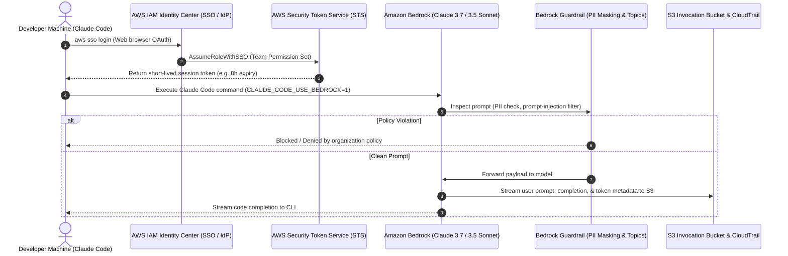

As engineering teams adopt **Claude Code** (Anthropic's agentic command-line tool), platform engineers and security administrators face a familiar friction: **developer agility vs. enterprise compliance.**

In a hobby project, developers export static API keys (`ANTHROPIC_API_KEY=sk-...`) into local `.env` files. In an enterprise organization, hardcoded API keys are an existential security risk—they cannot be attributed to human identities, they lack automated revocation, and they bypass corporate DLP, egress policies, and auditing controls.

The production-grade solution is to run Claude Code over **Amazon Bedrock**, underpinned by **AWS IAM Identity Center (SSO)**, temporary STS credential vending, and **Bedrock Guardrails**.

In this guide, we walk through the end-to-end architecture: provisioning multi-user SSO, configuration multiplexing on local machines, auditing AI invocations, and defending your posture during rigorous security and compliance audits.

---

## 1. The Core Architecture: Federated SSO & Credential Vending

Instead of long-lived API tokens, every developer request should be authenticated through your central Identity Provider (Okta, Google Workspace, Azure AD, or AWS IAM Identity Center) and bound to short-lived AWS STS credentials.



### Architectural Concepts in Play
1. **Federated Single Sign-On (SSO):** Developers do not have IAM user accounts or passwords. They log in with their corporate identity.
2. **Temporary Credential Vending:** Running `aws sso login` fetches short-lived tokens. If a laptop is stolen, credentials expire automatically without manual key rotation.
3. **Role-Based Access Control (RBAC):** Developers belong to groups (e.g., `Platform-Engineers`, `Backend-Devs`) mapped to permission sets granting `bedrock:InvokeModelWithResponseStream`.
4. **Client-Side Sandbox Multiplexing:** Using `CLAUDE_CONFIG_DIR` to maintain strict isolation between work accounts and personal environments on a single machine.

---

## 2. Step-by-Step Implementation

### Phase 1: AWS Administrator Setup

First, activate Bedrock model access and configure least-privilege IAM policies.

#### 1. Enable Anthropic Models
In the **Amazon Bedrock Console**, navigate to **Model catalog**, request access to the desired models (e.g., *Anthropic Claude 3.7 Sonnet* or *Claude 3.5 Sonnet*), and submit the standard use-case form.

#### 2. Create the IAM Permission Set
In **IAM Identity Center**, create a permission set named `ClaudeCodeDeveloperAccess` with the following inline policy:

```json
{
  "Version": "2012-10-17",
  "Statement": [
    {
      "Sid": "BedrockModelInvocation",
      "Effect": "Allow",
      "Action": [
        "bedrock:InvokeModel",
        "bedrock:InvokeModelWithResponseStream"
      ],
      "Resource": [
        "arn:aws:bedrock:*::foundation-model/anthropic.claude-*"
      ]
    },
    {
      "Sid": "BedrockEnforceGuardrails",
      "Effect": "Allow",
      "Action": [
        "bedrock:ApplyGuardrail"
      ],
      "Resource": "arn:aws:bedrock:*:*:guardrail/*"
    }
  ]
}
```

Assign this permission set to your developer groups in your target AWS account.

---

### Phase 2: Developer Workstation Setup

Developers configure their environment without touching static AWS keys.

#### 1. Configure the AWS SSO Profile
```bash
# Configure the SSO profile once
aws configure sso --profile enterprise-dev

# Follow the prompt:
# SSO Start URL: https://my-org.awsapps.com/start
# SSO Region: us-east-1
# CLI default client Region: us-east-1
```

#### 2. Authenticate
```bash
aws sso login --profile enterprise-dev
```
A browser tab opens for single sign-on. Once approved, temporary credentials are cached in `~/.aws/sso/cache/`.

#### 3. Install Claude Code & Configure Bedrock
Install the CLI tool:
```bash
npm install -g @anthropic-ai/claude-code
```

To route Claude Code through AWS Bedrock instead of the public Anthropic API, add the following exports to your shell profile (`~/.zshrc` or `~/.bashrc`):

```bash
export CLAUDE_CODE_USE_BEDROCK=1
export AWS_PROFILE=enterprise-dev
export AWS_REGION=us-east-1
```

---

### Phase 3: Profile Multiplexing (Dev vs. Prod vs. Personal)

Engineers often need to switch between different AWS roles (e.g., Sandbox vs. Staging) or use a personal Claude account for open-source work.

Claude Code stores session state, history, and tokens in `~/.claude/` by default. You can isolate these profiles cleanly using the `CLAUDE_CONFIG_DIR` environment variable:

```bash
# In ~/.zshrc or ~/.bashrc:

# Enterprise Work Profile (Bedrock via AWS SSO)
alias claude-work="CLAUDE_CONFIG_DIR=~/.claude-work \
  CLAUDE_CODE_USE_BEDROCK=1 \
  AWS_PROFILE=enterprise-dev \
  AWS_REGION=us-east-1 \
  claude"

# Personal Sandbox Profile (Direct Claude login)
alias claude-personal="CLAUDE_CONFIG_DIR=~/.claude-personal claude"
```

Each alias creates its own isolated sandbox directory with dedicated settings, credentials, and conversation histories.

---

## 3. Out-of-the-Box AWS Governance & Auditing

Deploying on Bedrock unlocks native AWS governance capabilities that direct consumer API keys cannot match:

| Governance Layer | AWS Native Service | What It Solves |
| :--- | :--- | :--- |
| **Input & Output Control** | **Bedrock Guardrails** | Blocks prompt injections, masks PII (SSNs, API keys), denies sensitive discussion topics. |
| **Data Auditing** | **Model Invocation Logging** | Captures complete input prompts, generated completions, and token counts directly to encrypted S3. |
| **Identity Traceability** | **AWS CloudTrail** | Records the exact human federated corporate email, timestamp, and IP address for every call. |
| **Threat Detection** | **GuardDuty AI Protection** | Flags anomalous API access patterns, compromised token usage, and automated scraping. |
| **FinOps & Telemetry** | **Amazon CloudWatch & Cost Explorer** | Tracks `InputTokenCount`, `OutputTokenCount`, and triggers alarms when guardrails intervene. |

### Correlating Who Said What: CloudTrail + Invocation Logs
A common audit requirement is: *"Can you prove which human engineer sent this prompt?"*

1. **CloudTrail** records the `AssumeRoleWithSSO` event, stamping the user's corporate email (`rohit@company.com`) and generating an STS `AccessKeyId` session token.
2. **Bedrock Invocation Logging** stores the prompt and model response in S3 alongside that same session token.
3. Using **Amazon Athena**, security teams run a fast SQL join on the session ID to tie any code query directly to the authenticated developer.

---

## 4. The AI Administrator Audit Defense Playbook

When compliance, SecOps, or external auditors evaluate your AI deployment, they focus on five governance pillars. Here is how an AI Administrator answers them:

### 1. Identity & Access Management (IAM)
* **Q: How is access provisioned and revoked?**  
  *Answer:* Centrally via IAM Identity Center tied to our corporate IdP. Adding a developer to an AD group grants the `bedrock:InvokeModel` permission set. Offboarding them from the IdP instantly revokes access across AWS and Claude Code.
* **Q: Can you prove developers aren't using long-lived static credentials?**  
  *Answer:* IAM user key creation is blocked via Service Control Policies (SCPs). Developers authenticate strictly with `aws sso login` vending short-lived STS tokens (8-hour maximum lifetime).
* **Q: How do you prevent 'Shadow AI'?**  
  *Answer:* Egress firewall rules block developer machines from reaching third-party LLM endpoints. Claude Code through Bedrock is our designated, compliant corporate channel.

### 2. Data Privacy & IP Ownership
* **Q: Where are prompts stored and who can read them?**  
  *Answer:* Model Invocation Logging writes encrypted payloads directly to an S3 bucket in a restricted Security account with AWS KMS Customer Managed Keys. Developers have zero read access.
* **Q: Does Anthropic or AWS use our code to train models?**  
  *Answer:* Under the AWS Bedrock shared responsibility model and enterprise terms, customer inputs and completions are strictly isolated inside the tenant boundary and are **never** used for model training.
* **Q: Who owns the copyright of generated code?**  
  *Answer:* Under AWS Service Terms, the customer retains 100% ownership of inputs and outputs. To prevent copyright contamination, all AI-generated code passes through standard license scanning (e.g., SonarQube / Black Duck) before merging.

### 3. Model Behavioral Safety & Kill Switches
* **Q: How do you stop prompt injections and PII leakage?**  
  *Answer:* We attach Bedrock Guardrails to all invocations. PII masking scrubs sensitive strings before the model processes them, and prompt-attack filters drop adversarial jailbreak attempts.
* **Q: What is your emergency kill switch?**  
  *Answer:* Administrators can detach the inline Bedrock policy from the SSO Permission Set. Active STS tokens are barred from invoking the model within seconds, instantly disabling access organization-wide.

### 4. Regulatory Compliance (HIPAA, GDPR, EU AI Act)
* **Q: Are we violating HIPAA or GDPR when engineers use Claude Code?**  
  *Answer:* Bedrock is a HIPAA-eligible service covered under our AWS Business Associate Addendum (BAA). For GDPR, Bedrock API endpoints are pinned to specific regions (e.g., `eu-central-1` Frankfurt), ensuring customer data never crosses geographic boundaries.

---

## 5. Decommissioning AI Projects: The 6-Phase Lifecycle

Retiring an AI tool or project requires careful orchestration to prevent data leaks, orphaned infrastructure, and surprise cloud bills:

```
[Phase 1: Planning]   ──► 30-day notice, identify owners, freeze dependencies
         │
[Phase 2: Archival]   ──► Lock invocation logs in S3 with Object Lock, snapshot DBs
         │
[Phase 3: Staged]     ──► Revoke bedrock:InvokeModel; run 14-day read-only soak
         │
[Phase 4: Teardown]   ──► Delete Provisioned Throughput, OpenSearch, S3 buckets
         │
[Phase 5: Cleanup]    ──► Prune IAM roles, KMS keys, and CloudWatch log groups
         │
[Phase 6: FinOps]     ──► Verify spend flatlines to $0; monitor for shadow AI
```

1. **Planning & Communication:** Send a 3-notice sequence (30-day notice, read-only freeze date, deletion date).
2. **Archival & Retention:** Snapshot databases, export Route53 DNS zones, and sync Bedrock invocation logs to a long-term S3 Glacier archive with S3 Object Lock for regulatory compliance.
3. **Staged Read-Only Mode:** Detach `bedrock:InvokeModel` permissions 14–30 days prior to hard deletion. This surfaces hidden upstream dependencies while recovery is trivial.
4. **Technical Teardown:** Cancel hourly **Provisioned Throughput** commitments first, destroy vector databases (OpenSearch Serverless / Knowledge Bases), and execute `terraform destroy`.
5. **Security Cleanup:** Remove stale IAM roles, custom policies, KMS key aliases, and CloudWatch log groups to eliminate residual security exposure.
6. **Verification & Shadow AI Monitoring:** Check AWS Cost Explorer to confirm project spend drops to zero, and monitor network traffic for spikes in unsanctioned third-party AI endpoints.

---

## 6. Enterprise Production Checklist

Before rolling out Claude Code on Amazon Bedrock across your development teams, verify the following:

- [ ] **Model Access:** Anthropic Claude models approved in target Bedrock regions.
- [ ] **Identity Federation:** AWS IAM Identity Center mapped to corporate IdP (Okta, Azure AD, Google).
- [ ] **Zero Static Keys:** IAM user creation restricted via AWS Organizations SCPs.
- [ ] **Guardrails Configured:** PII masking, topic denial, and prompt injection filters active.
- [ ] **Invocation Logging:** Bedrock logs streaming to an encrypted S3 bucket in a secure audit account.
- [ ] **Developer Tooling:** Standard shell aliases distributed with `CLAUDE_CODE_USE_BEDROCK=1` and `CLAUDE_CONFIG_DIR`.
- [ ] **Alerting:** CloudWatch alarm on `InvocationsIntervened` alerting SecOps of policy bypass attempts.
- [ ] **Decommissioning Runbook:** Step-by-step procedure documented for tool retirement and model lifecycle upgrades.
