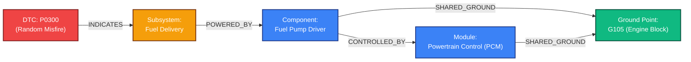
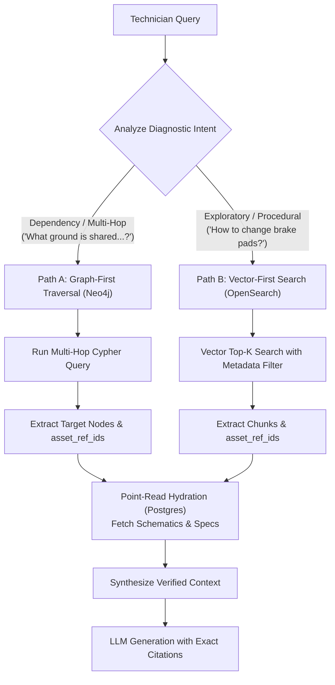

In the evolution of Retrieval-Augmented Generation, vector embeddings solved the **similarity problem**: given a paragraph of text, find other paragraphs that sound conceptually related.

For 80% of consumer-facing AI applications, that is sufficient.

But when you cross into industrial diagnostics, complex engineering systems, or aerospace maintenance, similarity is not what you need. You need **causality**, **dependency traversal**, and **multi-hop reasoning**.

Consider this real diagnostic question posed by a technician working on an electric vehicle or modern ICE powertrain:

> *"A vehicle threw fault code P0300 (Random Misfire). What ground point should I test that is shared between the Powertrain Control Module (PCM) and the fuel pump driver?"*

If you feed this into a traditional Vector RAG pipeline, the system fails. Why? Because the manual never wrote those three facts in a single paragraph. The fault code definition is on page 40; the PCM wiring pinout is on page 312; and the ground distribution schematic is in an electrical diagram appendix on page 780.

To a vector database, these chunks are strangers. To a **Knowledge Graph**, they are three hops away along explicit topological edges.

Here is why Knowledge Graphs are transforming enterprise RAG, and how to architect a production **"Linked Trinity" Datastore** that merges Vector, Relational, and Graph paradigms.

---

## 1. The Multi-Hop Wall: Where Vector RAG Breaks Down

Traditional vector RAG treats documents as a bag of independent text islands. When a question requires connecting disparate facts, standard semantic search encounters four fundamental walls:

```
┌────────────────────────────────────────────────────────────────────────┐
│                        Vector RAG vs. GraphRAG                         │
├────────────────────────────┬───────────────────────────────────────────┤
│ Vector RAG Limitation      │ GraphRAG Capability                       │
├────────────────────────────┼───────────────────────────────────────────┤
│ 1. Multi-Hop Failure       │ Traverses explicit edge relations         │
│    Cannot bridge page 40   │ `(P0300)-[:CAUSES]->(FuelIssue)-          │
│    to page 780             │ [:GROUNDED_AT]->(G105)`                   │
├────────────────────────────┼───────────────────────────────────────────┤
│ 2. Top-K Aggregation Blind │ Runs deterministic graph aggregations     │
│    Top-5 vectors miss 40   │ `MATCH (c:Component)-[:FAILS_DUE_TO]->(e) │
│    other common causes     │ RETURN c.name, count(e)`                  │
├────────────────────────────┼───────────────────────────────────────────┤
│ 3. Semantic Ambiguity      │ Resolves entities by strict UUID          │
│    Left control arm vs.    │ "Left Upper" and "Right Lower" are distinct│
│    Right control arm blur  │ nodes with non-overlapping relationships  │
├────────────────────────────┼───────────────────────────────────────────┤
│ 4. Black-Box Retrieval     │ 100% Explainable Path                     │
│    "0.84 cosine distance"  │ Inspectable Cypher query traversal        │
│    provides zero audit trail│ verifiable by human engineers            │
└────────────────────────────┴───────────────────────────────────────────┘
```

### The Diagnostic Dependency Chain
In technical troubleshooting, system states are connected by directional dependencies:



A technician doesn't want the LLM to write poetic prose about what a misfire feels like. They need the exact ground strap bolt location (`G105`) that simultaneously deprives the pump driver and PCM of voltage.

In a Graph database, this question translates to an instant declarative Cypher query:

```cypher
MATCH (d:DTC {code: 'P0300'})-[:INDICATES*1..3]->(c:Component)
MATCH (c)-[:SHARED_GROUND]->(g:GroundPoint)<-[:SHARED_GROUND]-(p:Module {name: 'PCM'})
RETURN g.code, g.location_description, c.name;
```

Execution time: **4 milliseconds**. Hallucination probability: **0%**.

---

## 2. Why Not Graph-Only? The Engineering Reality

If Knowledge Graphs are so potent, why not abandon vector databases and build everything inside Neo4j?

Because in high-volume enterprise engineering, **Graph databases carry severe trade-offs**:

1. **Ingestion Complexity is Massive:**  
   Transforming 100,000 PDF pages into a formal, typed ontology requires either brittle regex parsers or high-cost LLM entity extraction agents that multiply ETL cost by 10x.
2. **Horizontal Scaling is Hard:**  
   Distributed vector databases (OpenSearch, Milvus) shard across nodes effortlessly. Sharding multi-hop graph traversals across distributed machines remains one of computer science’s classic hard problems.
3. **Flat Manuals Don't Need Graphs:**  
   90% of vehicle maintenance steps are flat procedures (*"How to replace cabin air filter"*). Building graph relationships for an air filter replacement adds massive overhead with zero diagnostic payoff.

The answer is neither "Vector Only" nor "Graph Only." The answer is the **Linked Trinity**.

---

## 3. The "Linked Trinity" Datastore Architecture

The Linked Trinity unifies three distinct database paradigms into a synchronized storage fabric:

```mermaid
graph TD
    classDef vector fill:#1e293b,stroke:#06b6d4,stroke-width:2px,color:#f8fafc;
    classDef relational fill:#1e293b,stroke:#3b82f6,stroke-width:2px,color:#f8fafc;
    classDef graph fill:#1e293b,stroke:#a855f7,stroke-width:2px,color:#f8fafc;
    classDef link fill:#0f172a,stroke:#f59e0b,stroke-width:2px,color:#f59e0b;

    subgraph Trinity ["The Linked Trinity Storage Fabric"]
        V[("Vector Store (OpenSearch)<br/>• Dense Embeddings<br/>• Keyword Search (BM25)<br/>• Fast Top-K Similarity")]:::vector
        R[("Relational / Object Store (Postgres + S3)<br/>• Raw Markdown Tables<br/>• Wiring Schematics (SVG)<br/>• Source of Truth")]:::relational
        G[("Knowledge Graph (Neo4j)<br/>• Component Topologies<br/>• Fault Code Chains<br/>• Multi-Hop Dependencies")]:::graph
    end

    ID(["Universal Deterministic Hash: asset_ref_id"]):::link

    V <--->|Bound by asset_ref_id| ID
    R <--->|Bound by asset_ref_id| ID
    G <--->|Bound by asset_ref_id| ID
```

### How the Trinity Coordinates:
1. **The Vector Store (OpenSearch / Pinecone):**
   Handles unstructured similarity and natural language entry points.
2. **The Knowledge Graph (Neo4j / AWS Neptune):**
   Stores entities (`DTC`, `Part`, `Connector`, `Ground`) and formal relationships (`MONITORS`, `POWERS`, `TRIGGERS`).
3. **The Relational Store (PostgreSQL):**
   Stores the actual heavy, auditable payloads (the 20-row torque table, full PDF coordinates, and SVG wiring diagrams).

**The glue is the shared `asset_ref_id`**. Every node in Neo4j and every vector chunk in OpenSearch contains a foreign pointer back to the exact PostgreSQL row containing the source asset.

---

## 4. Dual-Path Query Orchestration

At runtime, the RAG Orchestrator acts as an intelligent traffic controller:



### Implementing Graph Traversal with Relational Hydration:

```python
from neo4j import GraphDatabase
import psycopg2
from typing import Dict, Any, List

class LinkedTrinityOrchestrator:
    def __init__(self, neo4j_uri, neo4j_auth, pg_pool):
        self.driver = GraphDatabase.driver(neo4j_uri, auth=neo4j_auth)
        self.pg_pool = pg_pool

    def resolve_diagnostic_dependency(self, dtc_code: str, target_module: str) -> List[Dict[str, Any]]:
        # Step 1: Traverse topological dependency chain in Neo4j
        cypher_query = """
        MATCH (d:DTC {code: $dtc})-[:INDICATES*1..3]->(c:Component)
        MATCH (c)-[:SHARED_GROUND]->(g:GroundPoint)<-[:SHARED_GROUND]-(m:Module {name: $module})
        RETURN g.code AS ground_code, 
               g.location AS location, 
               g.asset_ref_id AS asset_ref_id,
               c.name AS affected_component
        """
        
        graph_records = []
        with self.driver.session() as session:
            result = session.run(cypher_query, dtc=dtc_code, module=target_module)
            for record in result:
                graph_records.append(record.data())

        if not graph_records:
            return []

        # Step 2: Hydrate full wiring schematic & torque from PostgreSQL
        asset_ids = [r["asset_ref_id"] for r in graph_records if r.get("asset_ref_id")]
        
        hydrated_context = []
        with self.pg_pool.getconn() as conn:
            with conn.cursor() as cur:
                cur.execute(
                    """
                    SELECT asset_id, raw_content, s3_highres_url 
                    FROM complex_assets 
                    WHERE asset_id = ANY(%s)
                    """,
                    (asset_ids,)
                )
                assets_by_id = {row[0]: {"content": row[1], "url": row[2]} for row in cur.fetchall()}

        for rec in graph_records:
            asset_info = assets_by_id.get(rec["asset_ref_id"], {})
            hydrated_context.append({
                "ground_point": rec["ground_code"],
                "component": rec["affected_component"],
                "location_notes": rec["location"],
                "schematic_diagram": asset_info.get("url"),
                "repair_table": asset_info.get("content")
            })

        return hydrated_context
```

---

## 5. Standardized Ontologies vs. Data Drift

A recurring trap in enterprise Knowledge Graphs is attempting to write a bespoke entity parser for every new manual or equipment manufacturer.

If Ford calls a sensor `ECT_Sensor`, Toyota calls it `Coolant_Temp_Probe`, and Tesla calls it `Thermal_Sensor_Loop_1`, naive NER pipelines generate disconnected graph islands.

To prevent graph rot:
1. **Maintain a Standardized Core Schema:**
   Enforce immutable node types: `[:VEHICLE]`, `[:SYSTEM]`, `[:COMPONENT]`, `[:DTC]`, `[:GROUND]`.
2. **Map Synonyms to Normalized Entity IDs:**
   During the ingestion pipeline, pass candidate component names through an entity resolution catalog before writing nodes to the graph.
3. **Preserve Raw Terminology in Attributes:**
   Store `display_name: "Coolant Temp Probe"` on the node, but index the normalized node type as `type: "ENGINE_COOLANT_TEMP_SENSOR"`.

---

## 6. Production Architecture Checklist

When upgrading a mission-critical RAG pipeline with Knowledge Graphs:

- [ ] **Reserve Graph Traversal for Multi-Hop Queries:** Do not route simple procedural searches through Neo4j; use fast vector metadata filters instead.
- [ ] **Unify Primary Keys via Deterministic Hashes:** Ensure vector documents, graph nodes, and relational tables all share identical `asset_ref_id` fingerprints.
- [ ] **Enforce Atomic Multi-Database Writes:** If the Neo4j node commit fails during ingestion, roll back the vector insertion to avoid broken cross-store pointers.
- [ ] **Implement Intent Classification:** Classify user intent before execution to route queries down the Vector-First path (<25ms) or Graph-First path (~40ms).
- [ ] **Benchmark Latency Budgets:** Cap multi-hop graph depth at 3 hops in production Cypher queries to guarantee sub-50ms graph query latency.
