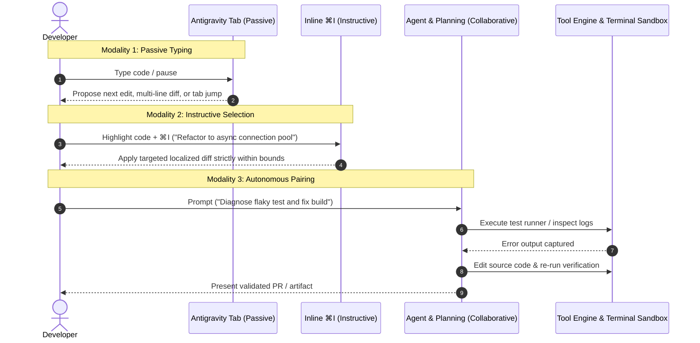

Software engineering is undergoing a tectonic shift. For the past two years, AI in the IDE has largely meant a sidebar chatbot or an inline snippet autocomplete. While helpful, these systems remain isolated observers—unable to independently verify code, navigate complex directories, run build loops, or interact with external toolchains.

**Google Antigravity (AGY)** represents the next evolutionary step: a unified, AI-first developer platform that bridges passive intent prediction with autonomous, tool-executing agent pairing across the entire software development lifecycle.

In this deep dive, we break down the architecture of Antigravity: its four distinct surfaces, three interaction modalities, hierarchical customization engine, and programmatic Python SDK.

---

## 1. The Multi-Surface Topology

Unlike single-binary tools, Antigravity operates across a four-surface topology designed to meet developers wherever they work:

```
┌────────────────────────────────────────────────────────┐
│             Google Antigravity Platform                │
├──────────────┬──────────────┬─────────────┬────────────┤
│ Antigravity  │ Antigravity  │ Antigravity │ Python SDK │
│     IDE      │     2.0      │  CLI (agy)  │ (Program-  │
│  (In-Editor) │  (Desktop)   │  (Terminal) │   matic)   │
└──────────────┴──────────────┴─────────────┴────────────┘
```

| Surface | Technical Architecture | Primary Workflow |
| :--- | :--- | :--- |
| **Antigravity IDE** | Custom VS Code distribution with deep kernel hooks | Active daily coding, inline diff inspection, single-keystroke tab jumps, and editor-centric pairing. |
| **Antigravity 2.0** | Standalone Electron desktop workspace | Multi-agent orchestration, parallel task canvas, browser session debugging, and long-running scheduled background cron jobs. |
| **Antigravity CLI (`agy`)** | Lightweight native TUI & headless binary | Remote SSH environments, continuous integration (CI) test runners, and scriptable command automation. |
| **Python SDK** | Asynchronous client (`google-antigravity`) | Programmatic agent leasing, custom agentic test suites, and internal developer platform integrations. |

---

## 2. The Three Operational Modalities

A core architectural challenge in AI developer tools is cognitive load: when should the AI be silent, when should it assist, and when should it take the steering wheel? 

Antigravity formalizes this into three distinct interaction tiers:



### A. Passive: Antigravity Tab
Operating directly at the keystroke level, Antigravity Tab is not a standard n-gram completion engine. It is an **intent-prediction loop**:
- **Context Awareness:** Ingests active tab buffers, cursor telemetry, recent terminal outputs, and git status.
- **Supercomplete:** Predicts multi-line refactorings, deletions, and structural reorganizations in floating diff lenses.
- **Tab to Jump & Import:** Anticipates the next cursor landing site (e.g., jumping from a function definition to its caller) and auto-resolves missing imports as you type.

### B. Instructive: Inline Modality (<kbd>⌘I</kbd> / <kbd>Ctrl+I</kbd>)
When scoped intervention is required, highlighting code and pressing <kbd>⌘I</kbd> restricts the AI's execution boundary strictly to the selection. It excels at:
- Targeted algorithmic optimizations.
- Localized docstring and type-annotation generation.
- Explaining obfuscated legacy code without altering surrounding state.

### C. Collaborative: Agent & Planning Mode
For complex, multi-step engineering tasks, the system shifts into autonomous pairing:
- **Planning Mode:** Generates a structured execution plan before executing irreversible operations.
- **Tool Access:** Safely executes commands in a local terminal sandbox, reads and edits workspace files, launches headless browsers for visual validation, and interfaces with Model Context Protocol (MCP) servers.

---

## 3. The Customization Engine: Progressive Disclosure

Enterprise repositories possess unique standards, build conventions, and security boundaries. Antigravity discovers and enforces customizations using a hierarchical priority model:

```
[1. Workspace Customizations: .agents/]  (Highest Priority — Committed to Git)
                 │
[2. Directory Rules: GEMINI.md / AGENTS.md]
                 │
[3. Global Config: ~/.gemini/config/]    (Developer Machine Preferences)
                 │
[4. Built-in Platform Standard Library]   (Lowest Priority / Fallback)
```

### Key Customization Primitives
1. **Skills (`.agents/skills/<name>/SKILL.md`):** Modular runbooks that teach the agent specific procedural workflows. Skills use **progressive disclosure**—only their frontmatter `name` and `description` are loaded into the initial context window, conserving tokens until activated by relevance.
2. **Rules (`GEMINI.md`, `AGENTS.md`, `.agents/rules/*.md`):** Persistent guardrails governing coding standards, naming conventions, and architectural constraints.
3. **Model Context Protocol (MCP):** Connects the agent to custom internal tools, database inspectors, or issue trackers defined in `mcp_config.json`.
4. **Lifecycle Hooks (`hooks.json`):** Intercepts execution before or after tool actions (e.g., running a security scan prior to executing bash scripts).

---

## 4. Programmatic Agent Leasing: Python SDK

Beyond the visual IDE, developers can orchestrate Antigravity agents programmatically via the `google-antigravity` Python SDK:

```python
import asyncio
import sys
from google.antigravity import Agent, LocalAgentConfig, CapabilitiesConfig

async def automated_code_review_pipeline(pr_diff: str):
    # Configure the agent with explicit capability boundaries
    config = LocalAgentConfig(
        system_instructions="""
        You are a senior security and systems engineering reviewer.
        Analyze incoming git diffs for concurrency bottlenecks, resource leaks,
        and unauthenticated API invocations.
        """,
        capabilities=CapabilitiesConfig(
            allow_run_command=True,     # Grants terminal command execution
            allow_file_write=False,     # Read-only audit mode
        ),
    )

    # Spawn an agent session using the async context manager
    async with Agent(config) as agent:
        prompt = f"Perform a strict security audit on this diff:\n\n{pr_diff}"
        response = await agent.chat(prompt)

        # Stream response tokens in real-time
        async for token in response:
            sys.stdout.write(token)
            sys.stdout.flush()
        print()

if __name__ == "__main__":
    sample_diff = "diff --git a/app.py b/app.py\n+ os.system(f'ping {user_input}')"
    asyncio.run(automated_code_review_pipeline(sample_diff))
```

This makes it trivial to embed autonomous coding agents directly into CI/CD pipelines, automated regression triage bots, or internal developer platforms (IDPs).

---

## 5. Security, Permissions & Sandboxing

Allowing an autonomous AI agent to execute shell commands and modify file systems requires strict security guarantees. Antigravity provides enterprise-grade operational controls:

* **Tool Execution Policies:** Configurable modes ranging from `always-proceed` (high trust) to `request-review` and `strict-sandbox`.
* **Containerized Terminal Sandboxing:** Restricts terminal execution to isolated virtualization layers, preventing accidental local directory contamination.
* **Non-Workspace File Scoping:** The agent is barred from reading or writing files outside the active workspace directory unless explicitly approved.
* **Domain Allowlists:** Browser automation subagents can be restricted to specific testing domains (e.g., `localhost` and internal staging endpoints), preventing data exfiltration to unauthorized web destinations.

---

## 6. Enterprise Production Checklist

When establishing an AI-first workflow with Antigravity across your engineering organization:

- [ ] **Standardize Workspace Rules:** Place common style guides and architectural conventions in root `GEMINI.md` or `.agents/rules/`.
- [ ] **Encapsulate Common Runbooks:** Convert repetitive engineering procedures (PR generation, release tagging, schema migrations) into workspace `.agents/skills/`.
- [ ] **Configure Sandboxed Tool Execution:** Enforce `request-review` or sandbox policies on developer workstations for destructive operations.
- [ ] **Integrate MCP Connectors:** Expose internal documentation, staging databases, and issue trackers via standard Model Context Protocol servers.
- [ ] **CI/CD Agent Validation:** Utilize the Python SDK in continuous integration to automate linting, documentation verification, and automated PR reviews.
