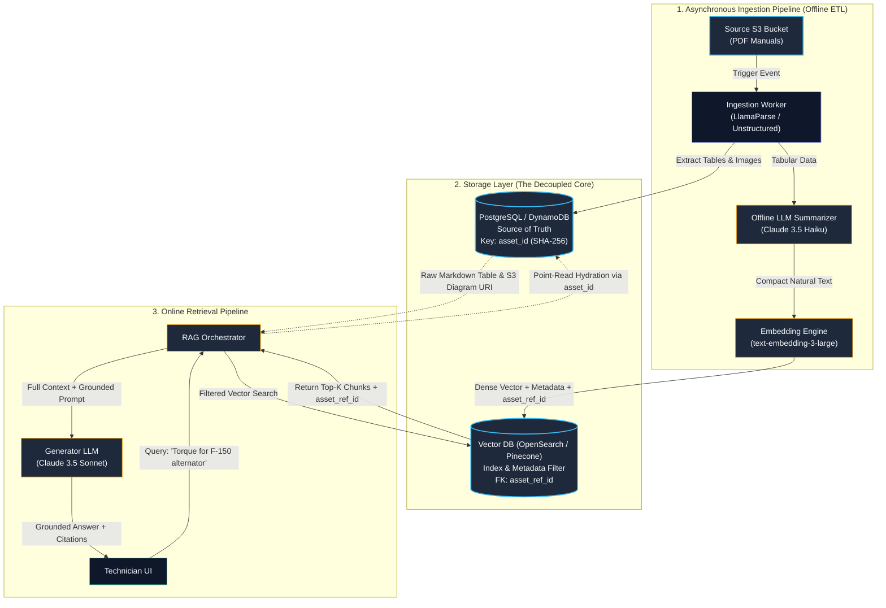
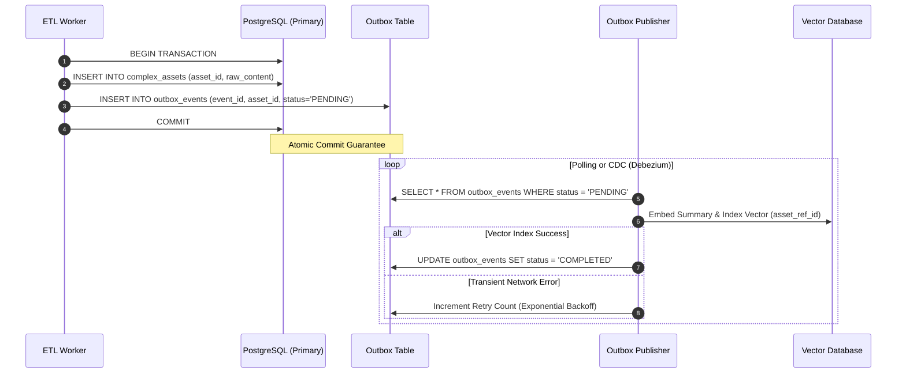

When software engineers transition from toy RAG tutorials to production enterprise systems, their first instinct is almost universally the same: chunk everything into 500-token snippets, generate vector embeddings, and dump both the vector and raw text into a single vector database like Pinecone, Weaviate, or Chroma.

In a tutorial demoing a customer support bot for a simple SaaS FAQ, this naive approach works well enough.

Then reality strikes. You are tasked with designing an AI diagnostic assistant for dealership technicians across 500 repair facilities. Your corpus isn't crisp markdown FAQs; it consists of 50,000 PDF workshop manuals, wiring schematics, pinout charts, and 50-row torque specification tables spanning 30 years of vehicle models.

On day one, a technician on the shop floor asks:

> *"What is the exact torque sequence and specification for the 2022 F-150 alternator mounting bolts?"*

Your naive vector search matches a chunk with an 84% cosine similarity score. But the retrieved snippet severed row 4 from row 5 of the markdown table. The LLM guesses the missing unit or conflates the alternator bracket bolt with the water pump bolt. A bolt shears off at 65 mph on the highway.

In safety-critical technical domains, **ragged chunking isn't a minor accuracy dip—it's catastrophic system failure**.

Here is how we design a production-grade, decoupled **Dual-Database RAG Architecture** to solve this.

---

## 1. Why the Single Vector DB Pattern Fails

Treating a vector database as both an index and a primary document store introduces three architectural anti-patterns:

```
┌──────────────────────────────────────────────────────────────┐
│             The Naive Anti-Pattern (Single Vector DB)         │
├──────────────────────────────────────────────────────────────┤
│  [Heavy Markdown Tables + Dense Text + OCR Blobs + Vectors]  │
│                                                              │
│  ✖ Massive In-Memory Footprint (HNSW index bloated with text) │
│  ✖ Truncated / Severed Tabular Data                          │
│  ✖ Zero Document Deduplication Across Model Revisions        │
│  ✖ No ACID Guarantees or Audit Lineage                       │
└──────────────────────────────────────────────────────────────┘
```

1. **Index Bloat & Degrading RAM Efficiency:**  
   Vector indexes like HNSW (Hierarchical Navigable Small World) must keep graphs in memory for low-latency traversal. Storing massive raw markdown payloads, high-res image coordinate metadata, and full OCR dumps inside the vector index wastes precious RAM and slows down nearest-neighbor searches.

2. **Semantic Blur on Tabular Data:**  
   Embedding models (such as `text-embedding-3-large`) map tabular markdown (`| Part | Spec |`) into dense vector representations. But multi-row tables are fundamentally non-linear relations. When two dozen bolts share identical terminology within a table, vector distance metrics collapse, causing erratic retrieval.

3. **Repetition & Deduplication Failures:**  
   In fleet documentation, identical component tables (e.g., standard M8 bolt torques) appear across hundreds of model manuals. Storing 5,000 identical 10KB markdown chunks in the vector database creates redundant vectors that crowd out the top-K retrieval candidates.

---

## 2. The Solution: Decoupled Dual-Database Architecture

To scale cleanly, we split concerns between **Semantic Indexing** and **Ground Truth Storage**:



### The Architectural Roles:

* **PostgreSQL / Amazon DynamoDB (Source of Truth):**
  Houses the complete, uncompressed, raw assets—full Markdown tables, wiring diagram base64/S3 URIs, document version lineages, and change histories.
* **Vector DB (OpenSearch Serverless / Pinecone):**
  Contains *only* high-dimensional embeddings, concise natural language summaries of complex assets, and indexed metadata properties (`make`, `model`, `year`, `system`) used for hard pre-filtering.

The bridge between these two disparate worlds is a single, deterministic identifier: **`asset_ref_id`**.

---

## 3. Ingestion Mechanics: Generating Deterministic Asset Hashes

How do we reliably link a vector search result to a 10KB raw markdown table without distributed race conditions?

Instead of generating arbitrary UUIDs, we compute a **deterministic SHA-256 hash of the normalized asset payload**:

```python
import hashlib
import json
from typing import Dict, Any, Optional

def generate_asset_id(raw_content: str, asset_type: str) -> str:
    """
    Generates a deterministic SHA-256 fingerprint for complex assets.
    Guarantees global deduplication across thousands of service manuals.
    """
    normalized_content = raw_content.strip().replace("\r\n", "\n")
    payload = f"{asset_type}:{normalized_content}".encode("utf-8")
    return hashlib.sha256(payload).hexdigest()
```

### The Ingestion Sequence:
1. **Extraction:** The worker parses page 142 of `2022_F150_Manual.pdf` and extracts a 6-row torque table.
2. **Deterministic Fingerprint:** The SHA-256 hash (`e3b0c44...`) is generated as the `asset_id`.
3. **Primary Write (PostgreSQL):** The raw table is persisted into PostgreSQL with `ON CONFLICT (asset_id) DO NOTHING`. If 40 other Ford manuals share this standard bolt table, the write succeeds instantly with zero storage duplication.
4. **Summary Generation:** An offline, cost-effective LLM (e.g., Claude 3.5 Haiku) generates an embedding-friendly summary:
   > *"Alternator mounting bolt specifications for 2022 Ford F-150 3.5L EcoBoost. Lists primary bracket bolt torque at 40 Nm (30 lb-ft) and secondary tensioner bolt at 25 Nm."*
5. **Vector Index Write:** The summary is embedded into a 1536-dimensional vector and stored in the vector database with `asset_ref_id = "e3b0c44..."`.

---

## 4. Resolving Distributed Two-Phase Writes

What happens if the worker commits the raw asset to PostgreSQL, but the network crashes before indexing into OpenSearch? Or worse, what if the vector is indexed but the Postgres transaction rolls back?

A dangling `asset_ref_id` causes runtime `404 Asset Not Found` errors when a technician asks a question.

To prevent this in high-throughput pipelines, we adopt the **Transactional Outbox Pattern**:



By decoupling vector ingestion via an outbox event log, we guarantee **at-least-once vector indexing** while maintaining strict referential integrity.

---

## 5. Production Schemas: PostgreSQL & Vector DB

Here are the concrete database schemas powering this architecture:

### 1. PostgreSQL Source of Truth Schema

```sql
CREATE TYPE asset_type_enum AS ENUM ('MARKDOWN_TABLE', 'WIRING_DIAGRAM', 'SCHEMATIC_IMAGE', 'PROCEDURE_BLOCK');

CREATE TABLE documents (
    doc_id UUID PRIMARY KEY DEFAULT gen_random_uuid(),
    file_name VARCHAR(255) NOT NULL,
    vehicle_make VARCHAR(64) NOT NULL,
    vehicle_model VARCHAR(64) NOT NULL,
    model_year INT NOT NULL,
    s3_uri TEXT NOT NULL,
    version VARCHAR(32) NOT NULL DEFAULT '1.0.0',
    created_at TIMESTAMP WITH TIME ZONE DEFAULT NOW()
);

CREATE TABLE complex_assets (
    asset_id CHAR(64) PRIMARY KEY, -- Deterministic SHA-256 hash
    doc_id UUID REFERENCES documents(doc_id) ON DELETE CASCADE,
    page_number INT NOT NULL,
    asset_type asset_type_enum NOT NULL,
    raw_content TEXT NOT NULL, -- Full markdown table or diagram SVG/JSON
    s3_highres_url TEXT, -- Link to full resolution wiring diagram
    created_at TIMESTAMP WITH TIME ZONE DEFAULT NOW()
);

CREATE INDEX idx_complex_assets_doc ON complex_assets(doc_id, page_number);
```

### 2. Vector DB Index Schema (OpenSearch / Pinecone)

```json
{
  "chunk_id": "chunk_f150_2022_alt_091",
  "embedding": [0.0124, -0.0452, 0.0891, "...(1536 dims)"],
  "text_content": "Table summary: Alternator mounting bolt torque specs for 2022 Ford F-150. Upper bolt requires 40 Nm, lower pivot bolt 60 Nm.",
  "asset_ref_id": "e3b0c44298fc1c149afbf4c8996fb92427ae41e4649b934ca495991b7852b855",
  "metadata": {
    "doc_id": "d13a9601-3829-4171-8bc4-a55e905d4b89",
    "page_num": 142,
    "vehicle_make": "Ford",
    "vehicle_model": "F-150",
    "vehicle_year": 2022,
    "system_category": "Electrical",
    "subsystem": "Charging",
    "chunk_type": "table_summary",
    "part_numbers": ["GL-891", "10300-AA"]
  }
}
```

---

## 6. The Online Runtime Hydration Pattern

During query execution, the RAG orchestrator executes an efficient **two-phase read**:

```python
import psycopg2
from psycopg2.extras import RealDictCursor
from typing import List, Dict, Any

class DualDatabaseRetriever:
    def __init__(self, vector_client, pg_conn_pool):
        self.vector_client = vector_client
        self.pg_pool = pg_conn_pool

    def search_and_hydrate(
        self, 
        query: str, 
        filters: Dict[str, Any], 
        top_k: int = 5
    ) -> List[Dict[str, Any]]:
        # Phase 1: High-Speed Vector Query with Pre-Filtering
        search_results = self.vector_client.search(
            query=query,
            filter={
                "vehicle_make": filters["make"],
                "vehicle_model": filters["model"],
                "vehicle_year": filters["year"]
            },
            top_k=top_k
        )

        asset_ids_to_hydrate = [
            hit["asset_ref_id"] 
            for hit in search_results 
            if hit.get("asset_ref_id")
        ]

        if not asset_ids_to_hydrate:
            return search_results

        # Phase 2: Batch Hydration via Single Relational Query
        hydrated_assets = {}
        with self.pg_pool.getconn() as conn:
            with conn.cursor(cursor_factory=RealDictCursor) as cur:
                cur.execute(
                    """
                    SELECT asset_id, asset_type, raw_content, s3_highres_url 
                    FROM complex_assets 
                    WHERE asset_id = ANY(%s)
                    """,
                    (asset_ids_to_hydrate,)
                )
                for row in cur.fetchall():
                    hydrated_assets[row["asset_id"]] = row

        # Merge raw ground truth back into LLM context window
        enriched_chunks = []
        for hit in search_results:
            asset_ref = hit.get("asset_ref_id")
            if asset_ref and asset_ref in hydrated_assets:
                raw_data = hydrated_assets[asset_ref]
                enriched_chunks.append({
                    "type": raw_data["asset_type"],
                    "content": raw_data["raw_content"], # Injects exact markdown table
                    "image_url": raw_data["s3_highres_url"],
                    "citation": f"Manual {hit['metadata']['doc_id']}, Page {hit['metadata']['page_num']}"
                })
            else:
                enriched_chunks.append({
                    "type": "text",
                    "content": hit["text_content"],
                    "citation": f"Page {hit['metadata']['page_num']}"
                })

        return enriched_chunks
```

Notice the latency profile:
1. OpenSearch executes vector + metadata pre-filtering in **~15ms**.
2. PostgreSQL executes an indexed batch point lookup (`asset_id = ANY(...)`) in **~3ms**.
3. The total retrieval overhead is **under 20ms**, while passing 100% accurate, uncorrupted markdown tables to the generation model.

---

## 7. Production Engineering Takeaways

Before deploying a technical documentation assistant to field technicians:

- [ ] **Decouple Vector Indexing from Heavy Blobs:** Never store raw tabular strings or diagram blobs directly inside vector node attributes.
- [ ] **Hash Assets for Deduplication:** Use SHA-256 content hashes as asset primary keys to eliminate duplicate technical tables across manual updates.
- [ ] **Summarize for Vectors, Hydrate for Generation:** Embed concise natural language summaries generated by cheap offline LLMs, but always inject raw Markdown tables into the prompt.
- [ ] **Enforce Transactional Consistency:** Protect your dual-database architecture using the Transactional Outbox Pattern to eliminate dangling references.
- [ ] **Hardware Pre-Filtering:** Filter by vehicle make, model, and year before vector similarity ranking to cut search space by 99% and ensure zero cross-model hallucinations.
