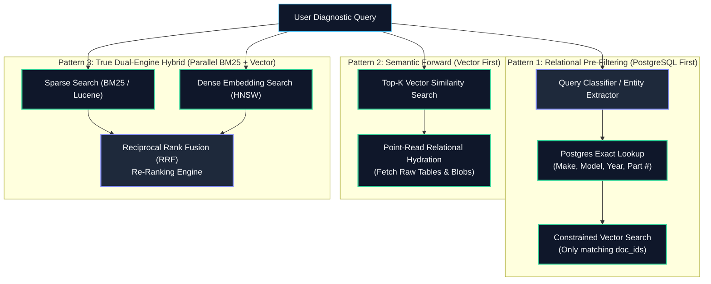
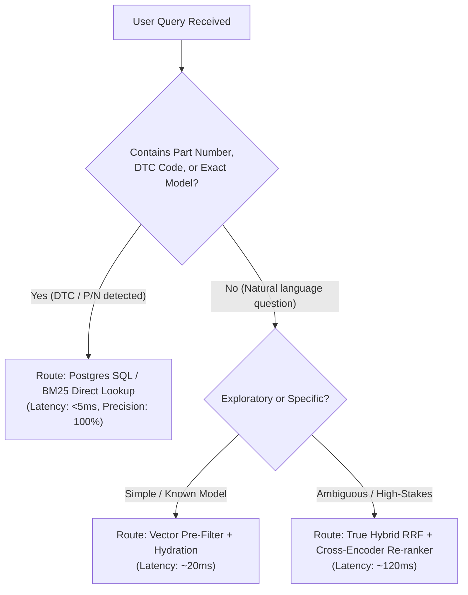

Ask an AI engineer how to improve retrieval quality in a RAG pipeline, and within thirty seconds someone will say: *"Just add Hybrid Search."*

It sounds deceptively straightforward: merge vector embeddings with BM25 keyword search, apply Reciprocal Rank Fusion (RRF), and enjoy the best of both worlds.

Except in enterprise systems with strict latency SLAs and safety-critical documentation, **hybrid search is not a free lunch**. It is a continuous tug-of-war between query latency, operational compute budgets, and retrieval precision. In fact, there are entire categories of real-world queries where a naive hybrid search performs significantly *worse* than a basic relational SQL query.

Let’s dissect why semantic search breaks down in the wild, when hybrid search introduces dangerous latency bottlenecks, and how to select the right retrieval strategy for your architecture.

---

## 1. Where Pure Semantic Search Fails

Vector search maps words and concepts into high-dimensional geometric spaces based on contextual co-occurrence. This makes it magical for exploratory natural language questions:

```
Technician Query: "My steering wheel shakes only at high speed."
Manual Heading:   "Steering Linkage Imbalance & High-Speed Vibration Tree"
Cosine Match:     0.89 (High Relevance)
```

The embedding model understands that *"shakes"* is synonymous with *"vibration"*, bridging the vocabulary gap effortlessly.

However, in heavy industrial, automotive, and technical documentation, queries frequently demand **exact fact retrieval**, not conceptual closeness. Here is where pure vector search falls off a cliff:

```
┌────────────────────────────────────────────────────────────────────────┐
│                      Semantic Search Failure Modes                     │
├────────────────────────────────┬───────────────────────────────────────┤
│ Failure Mode                   │ Real-World Manifestation              │
├────────────────────────────────┼───────────────────────────────────────┤
│ 1. Component Part Numbers      │ "Procedures for P/N 14-55X"           │
│                                │ Embedding treats '14-55X' as arbitrary│
│                                │ tokens; conflates with '14-56X'       │
├────────────────────────────────┼───────────────────────────────────────┤
│ 2. Diagnostic Trouble Codes    │ "Torque specs for error P0300"        │
│    (DTCs)                      │ P0300 (random misfire) vectors cluster│
│                                │ identically to P0301 (cyl 1) and      │
│                                │ P0302 (cyl 2), confusing the LLM      │
├────────────────────────────────┼───────────────────────────────────────┤
│ 3. Exact Model & Spec Filters  │ "2019 Mustang GT 5.0L Brake Torque"   │
│                                │ Semantic search pulls from 2018 or    │
│                                │ 2020 trims due to identical verbiage  │
└────────────────────────────────┴───────────────────────────────────────┘
```

### The Part Number Catastrophe
Consider a technician asking for installation guidelines on **Part Number `14-55X`**.

In subword tokenization (BPE/WordPiece), `14-55X` gets sliced into arbitrary fragments: `["14", "-", "55", "X"]`. In high-dimensional vector space, `14-55X` and `14-56X` reside microscopic fractions of a millimeter apart.

If your vector store returns the procedure for `14-56X` (a completely different bracket with a lower load threshold), your generative LLM will synthesize installation guidelines with complete confidence. In a manufacturing or automotive setting, that error damages hardware.

A simple relational SQL index lookup:
```sql
SELECT procedure_text FROM component_catalog WHERE part_number = '14-55X';
```
executes in **0.8 milliseconds** with **100% deterministic precision**. Running an embedding model and vector search on this query isn't just wasteful—it is an active architectural risk.

---

## 2. The Three Hybrid Retrieval Patterns

To handle both natural language exploratory diagnostics and strict exact-match constraints, we evaluate three retrieval patterns:



### Pattern 1: Relational Pre-Filtering (Postgres First)
1. The orchestrator classifies the query to extract structured entities (`make: Ford`, `model: F-150`, `year: 2022`, `part: 14-55X`).
2. It queries PostgreSQL to locate matching `doc_id` or `asset_id` records.
3. It passes the resulting ID list as a hard boolean constraint to the vector database, which searches *only* within those candidate chunks.

### Pattern 2: Semantic Forward (Vector First)
1. The orchestrator runs an unconstrained top-K vector search against the whole corpus.
2. It inspects the retrieved chunks' `asset_ref_id` metadata.
3. It runs a batch point-read into PostgreSQL to fetch the raw ground truth tables and wiring diagrams.

### Pattern 3: True Dual-Engine Hybrid with Reciprocal Rank Fusion (RRF)
1. The orchestrator fires two asynchronous queries simultaneously:
   - **Sparse Lexical Search:** BM25 over raw tokenized text (exact keywords, part numbers, DTCs).
   - **Dense Vector Search:** Nearest-neighbor search over embeddings.
2. An algorithmic fusion layer merges both lists and re-scores candidates.

---

## 3. The Mathematics of Reciprocal Rank Fusion (RRF)

When combining BM25 scores (unbounded floats, e.g., `18.42`) with Cosine Similarity scores (bounded `[-1.0, 1.0]`), you cannot simply add them together. Raw score distributions fluctuate wildly across queries.

Production hybrid engines normalize rankings using **Reciprocal Rank Fusion (RRF)**:

$$\text{RRF\_Score}(d) = \sum_{m \in M} \frac{1}{k + r_m(d)}$$

Where:
* $M$ is the set of search systems (BM25 and Dense Vector).
* $r_m(d)$ is the rank position of document $d$ in system $m$ (1-indexed).
* $k$ is a smoothing constant (typically $k = 60$) that prevents top-ranked outliers from completely dominating the final score.

### Production Python Implementation of RRF:

```python
from typing import List, Dict, Any
from collections import defaultdict

def reciprocal_rank_fusion(
    bm25_results: List[Dict[str, Any]], 
    vector_results: List[Dict[str, Any]], 
    k: int = 60,
    top_n: int = 5
) -> List[Dict[str, Any]]:
    """
    Fuses sparse lexical (BM25) and dense semantic search results
    into a unified ranking without score calibration issues.
    """
    rrf_scores = defaultdict(float)
    doc_lookup = {}

    # Score sparse rankings
    for rank, doc in enumerate(bm25_results, start=1):
        doc_id = doc["id"]
        rrf_scores[doc_id] += 1.0 / (k + rank)
        doc_lookup[doc_id] = doc

    # Score dense vector rankings
    for rank, doc in enumerate(vector_results, start=1):
        doc_id = doc["id"]
        rrf_scores[doc_id] += 1.0 / (k + rank)
        if doc_id not in doc_lookup:
            doc_lookup[doc_id] = doc

    # Sort descending by fused RRF score
    sorted_docs = sorted(
        rrf_scores.items(), 
        key=lambda item: item[1], 
        reverse=True
    )

    fused_results = []
    for doc_id, score in sorted_docs[:top_n]:
        result = doc_lookup[doc_id].copy()
        result["rrf_score"] = score
        fused_results.append(result)

    return fused_results
```

---

## 4. Latency vs. Precision Trade-Off Matrix

Why not run True Hybrid RRF on every query? The answer lies in your **latency budget**:

| Metric / Dimension | Pattern 1: Postgres-First Pre-Filtering | Pattern 2: Vector-First Hydration | Pattern 3: True Hybrid RRF |
| :--- | :--- | :--- | :--- |
| **Typical Retrieval Latency** | 25ms – 40ms | 15ms – 25ms | **80ms – 180ms** |
| **Part Number / DTC Precision** | **100% (Deterministic)** | 40% – 65% (High Risk) | 95% – 99% |
| **Exploratory Query Precision** | Low (Fails if parser misclassifies) | **95% (High Recall)** | **98% (State of the Art)** |
| **Compute / DB Load** | Low (Point indexes) | Low (Single vector query) | **High (2 parallel queries + fusion)** |
| **Failure Point** | Entity classification error | Semantic drift on technical facts | Latency spike under concurrency |

### When True Hybrid Becomes a Bottleneck:
If 1,000 technicians query the system simultaneously at shift start:
* Running two full distributed queries (BM25 shard scan + OpenSearch HNSW vector traversal) doubles database IOPS.
* Merging and sorting top-100 candidate lists in application memory creates GC pressure.
* Total p99 latency balloons from 200ms to **1.8 seconds**, risking shop floor abandonment.

---

## 5. The Routing Decision Engine

Instead of blindly applying one pattern, enterprise RAG systems implement a **Deterministic Query Router**:



```python
import re
from typing import Literal

PART_NUMBER_PATTERN = re.compile(r'\b[A-Z0-9]{2,4}-[0-9]{3,5}[A-Z0-9]?\b', re.IGNORECASE)
DTC_CODE_PATTERN = re.compile(r'\b[PCBU][0-9]{4}\b', re.IGNORECASE)

def route_retrieval_strategy(query: str) -> Literal["EXACT_SQL", "SEMANTIC_HYDRATE", "TRUE_HYBRID"]:
    # Check for hard technical identifiers
    if PART_NUMBER_PATTERN.search(query) or DTC_CODE_PATTERN.search(query):
        return "EXACT_SQL"
    
    # Check if query is short and exploratory
    if len(query.split()) < 5:
        return "SEMANTIC_HYDRATE"
        
    # Default to balanced hybrid for nuanced complex queries
    return "TRUE_HYBRID"
```

---

## 6. Architecture Checklist for Engineering Teams

Before rolling out hybrid search to production:

- [ ] **Benchmark Tokenizer Collision:** Validate whether your vector embedding tokenizer preserves component part numbers and DTC codes intact.
- [ ] **Establish Latency SLAs:** Never use dual-engine hybrid RRF on queries with sub-50ms hard response requirements.
- [ ] **Tune RRF Smoothing ($k$):** Set $k = 60$ as baseline; lower values ($k = 20$) boost top-1 matches, while higher values ($k = 100$) favor broad consensus.
- [ ] **Implement Intent-Based Routing:** Don't waste vector compute on exact part lookups; route them to direct relational database indexes.
- [ ] **Monitor Cache Hit Rates:** Technicians repeat standard diagnostic queries. Layer a Redis semantic cache in front of hybrid retrieval to serve 40% of queries in <5ms.
